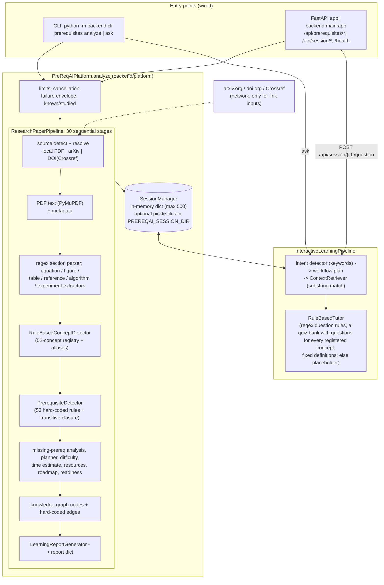
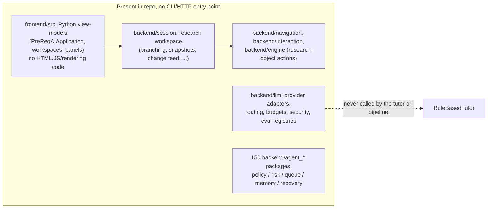

# PreReqAI — Architecture and Research-Readiness Assessment

**Audience:** a researcher deciding whether this project could support an arXiv paper.
**Basis:** everything below was read from the code, tests and docs in this repository (originally written at a commit that no longer exists in this checkout's history; later figures were re-checked at the commits named where they appear). Statements about behaviour were checked by running the code where noted. Anything unfinished, planned, or merely declared is marked **[NOT IMPLEMENTED]**, **[PARTIAL]** or **[UNUSED]**.

**Bottom line up front.** The part of this repository that is wired to a user-facing entry point is a small, deterministic, rule-based pipeline: PDF → section/equation heuristics → dictionary-based concept detection (52 hand-written concepts) → hard-coded prerequisite rules (53 rules over 8 base subjects) → study plan. There is **no machine-learning model in the loop**, no LLM is called anywhere on that path, and **there is no evaluation against real papers or human judgments** (`python -m backend.prereqai_eval` scores six small synthetic, author-labelled fixtures; its README lists why that is not a measurement of real-paper accuracy). Most of the repository's ~650k lines (see §3.7) are large, mostly unconnected scaffolding around that core. On its present evidence the project is a working prototype/engineering artifact, not a research result.

---

## 1. Problem

**Friction addressed (as stated by the code and README).** A learner who wants to read a research paper (initially transformers, diffusion, RL, graph ML) does not know which background topics they are missing. PreReqAI tries to turn a paper into: the concepts it uses, the prerequisite topics those concepts need, which of those the learner still has to study (given what they mark as known), an ordered study plan with hour estimates and curated links, a readiness percentage, and a way to ask follow-up questions (`README.md`, "Prerequisite Explorer", "Interactive Learning").

**Intended user.** An individual self-learner (e.g. someone with a general ML background opening a paper outside their sub-field). There is no user study, persona research, or usage data in the repository; this is inferred from the README and the CLI/HTTP surfaces.

**Stated scope limits (README / `docs/release-checklist.md`):** focused on four areas — transformers, diffusion, RL, graph ML; text-based PDFs only (no OCR); English keyword matching only.

**Secondary, unrelated product lines** that share the repository (see §3.5–3.6): a notebook-to-FastAPI generator, and a large "agent task recovery / policy governance" service layer. Neither addresses the learning problem above.

---

## 2. System overview

### 2.1 What is actually wired end to end

Data flow in words: a source string (path, arXiv link/ID, or DOI) is resolved to a local PDF; PyMuPDF extracts page text; a single mutable `Paper` object is passed through the stages in `_STAGES` (`backend/pipeline/research_paper_pipeline.py`), each stage enriching it; the final stage serialises it to a report dict; the platform wraps the report in a status envelope, stores a `LearningSession` holding the `Paper`, and returns a `session_id`. Learner progress (`known`/`studied`) is applied by re-deriving the plan/readiness sections of the report.

### 2.2 What exists but is **not** connected to the entry points above

Two exceptions to "unconnected": (a) `backend/main.py` mounts a `recovery_decision_routes` router and the CLI has a `recovery-decision` command, both over the agent-recovery layer (unrelated to papers; see §3.6); (b) `backend.session`, `backend.navigation`, `backend.interaction` and `backend.workflows` are *imported* by the tutor pipeline for a handful of small classes (enums, `LearningSession`, `QuestionManager`), so some of their code is loaded but the large majority is not exercised by the product path.

---

## 3. Components

### 3.1 Entry points and platform (wired)

| Module | Role | Connects to |
|---|---|---|
| `backend/cli.py`, `cli_prerequisites.py`, `cli_api_generation.py` | `argparse` CLI: `prerequisites analyze/ask`, `api-generation generate/check`, `recovery-decision ...`. Recovery/API-generation imports are lazy to keep start-up fast. | `PreReqAIPlatform`, `InteractiveLearningPipeline` |
| `backend/main.py`, `backend/api/*` | FastAPI app: upload/analyse (`POST /api/prerequisites/analyze`, file, arXiv/DOI source, or resumed plan), session read/delete/list, mark concept studied/known (POST/DELETE), plan as Markdown (`GET /api/session/{id}/plan`), question endpoint, `/health`. Uniform failure envelope (`status`, `stage`, `detail`, `hint`). CORS off unless `PREREQAI_CORS_ORIGINS` set. | `PreReqAIPlatform`, `session_manager` |
| `backend/platform/prereqai_platform.py` | Orchestrates one analysis: size/time limits, between-stage cancellation, diagnostics (per-stage timings), error classification (timeouts, missing file, encrypted PDF, bad link), `known`/`studied` handling, "did you mean" suggestions for concept names, final-state guard that turns an inconsistent result into a failure. | `ResearchPaperPipeline`, `session_manager` |
| `backend/study_plan_markdown.py` | Export/import of a Markdown checklist so progress survives between runs (`--plan-file`, `--resume`). | CLI, HTTP |

### 3.2 Analysis pipeline (wired) — `backend/pipeline/research_paper_pipeline.py`

A fixed list of 30 stages executed sequentially with per-stage wall-clock timing and a cancellation check between stages. Each stage's return type is checked. Stages (in order) and what each really does:

| Stage group | Module(s) | Method (as implemented) |
|---|---|---|
| Source detection/resolution | `backend/ingestion/research_source_detector.py`, `arxiv_resolver.py`, `doi_resolver.py`, `research_source_resolver.py` | Pattern-match the input as path/arXiv/DOI; download arXiv PDFs (cache directory, retry/recovery); DOIs: arXiv DOIs → arXiv, others → Crossref lookup for a publisher PDF link. Download URLs are checked to be public HTTPS (`is_public_https_url`) to avoid server-side request forgery. |
| Text extraction | `ingestion/pdf_ingestion_engine.py`, `text_cleaning.py`, `document_metadata_extractor.py` | PyMuPDF `get_text("text")` per page, light cleaning; metadata from the PDF and first page (author extraction is a heuristic and often "Unknown Author" per the release checklist). Warns on repaired/damaged PDFs and on PDFs with no extractable text (no OCR). |
| Structure | `backend/parsing/*` | `ScientificSectionParser`: one large regex of known headings plus numbered/roman-numeral title-case patterns; unmatched headings fold into the preceding section. `EquationExtractor`: any line matching `.+=.+` in a section (so prose lines containing "=" are also taken). Figure/table/reference/citation/algorithm/experiment/related-paper extractors are likewise regex/heuristic. |
| Concept detection | `backend/concepts/rule_based_concept_detector.py`, `concept_registry.py` | Case-insensitive whole-word counting of 52 registry concepts and their aliases over body text (bibliography sections excluded), after normalising ligatures, dashes and hyphenated line breaks; overlapping terms ("self-attention" vs "attention", "graph convolutional network" vs "convolutional network") are de-duplicated. Output: `{name, domain, occurrences}`. |
| Prerequisites | `backend/prerequisites/prerequisite_detector.py` | A dict of 53 `concept → [prerequisite, ...]` rules; a prerequisite is listed once with a reason naming every concept that needs it; transitive prerequisites are added. `confidence` is the share of the paper's rule-bearing concepts that need the prerequisite (not a certainty); `importance` is `essential` (needed by at least half of them) or `supporting`, with an `importance_reason`. Base prerequisites are only 8: Linear Algebra, Probability, Calculus, Information Theory, Neural Networks, Graphs, Markov Decision Process, Attention. |
| Plan | `missing_prerequisite_analyzer.py`, `prerequisite_learning_planner.py`, `study_time_estimator.py`, `difficulty_assessment_engine.py`, `difficulty_explanation_engine.py`, `study_action_plan_generator.py`, `prerequisite_justification_engine.py` | A prerequisite counts as covered only if the paper itself mentions it at least 3 times (`COVERAGE_MIN_MENTIONS`) or the learner marked it known; one or two mentions keep it in the plan (the reason says how often it was mentioned). Order from a 11-entry hard-coded table (unknown concepts sort last); hours from a 11-entry hard-coded table; days = `max(1, (hours+2)//3)`; difficulty level from the *count* of missing prerequisites (≤2 Beginner, ≤4 Intermediate, ≤6 Advanced, else Expert; score `min(5, 1+0.4·n)`; `Unknown` with score 0 when no concept was detected, because nothing was assessed). |
| Resources / progress | `backend/resources/*`, `backend/progress/*` | Lookup of 9 curated courses/articles (MIT OCW, Khan Academy, Coursera, CS224W, etc.) with hard-coded hours; readiness = completed/total planned concepts, "ready" at 100%. |
| Graph | `backend/graph/*` | Nodes for concepts, equations and algorithms; concept-to-concept edges from a hard-coded relationship table; paragraph co-occurrence edges. The node builder's own docstring says "Relationships will be added in future commits". A query/traversal engine and learning-path generator exist. |
| Report | `backend/reporting/learning_report_generator.py`, `backend/serialization/paper_serializer.py` | Serialises `Paper` to the report dict returned by the CLI `--json` and HTTP. Includes `concept_evidence`, `equations`, `prerequisite_tree`, `learning_plan`, `study_time`, `readiness`, `statistics`. |

### 3.3 Tutor and session layer (wired, minimal)

| Module | Role |
|---|---|
| `backend/session/session_manager.py`, `learning_session.py` | In-memory sessions (cap 500, idlest evicted). With `PREREQAI_SESSION_DIR` set, each session is also written as a **pickle** file (atomic temp-file swap, per-writer temp names, 30-day expiry, id must be a canonical UUID and match the file). Loading uses a restricted unpickler (commit `eda9b88`) that refuses classes outside `backend.*`; still keep the directory private. |
| `backend/pipeline/interactive_learning_pipeline.py` | For a question: keyword `LearningIntentDetector` → `LearningWorkflowPlanner` (maps an intent to 1–3 workflow types) → `ContextRetriever` (lower-cased substring match of concept names in the question, then sections containing them) → `RuleBasedTutor`; duplicate replies are removed. |
| `backend/tutor/rule_based_tutor.py` (540 lines) | Self-described as "Temporary tutor used before the LLM tutor is introduced." Answers via ordered regex rules: quiz (12-concept `quiz_bank`), per-concept time, resources, "which prerequisites does X need", built-in definitions/justifications, paper overview, study-plan questions ("what first / how long / how hard / am I ready"). Alias spellings (SGD, RNN, backprop) are rewritten to canonical names. **Anything else returns the literal string "A tutoring model has not yet been configured."** and the response carries a `warnings` entry saying so. `TutorPromptBuilder` builds an LLM prompt string (stored as `last_prompt`) that is never sent anywhere. |

### 3.4 Not wired: research workspace, navigation, interaction, front-end view-models

| Area | Size / location | Status |
|---|---|---|
| Research workspace (sessions, checkpoints, branching/lineage, tags/collections, snapshots + transactional import, integrity auditor, change feed, gateway, capability discovery) | ~1,940 files under `backend/session/` (~194k non-test lines); most of the ~1,370 files in `backend/tests/` test this and the other unwired packages | **[UNUSED by CLI/HTTP]**. Documented in `docs/research-workspace-architecture.md` as the backend for a *future* front-end. `docs/release-checklist.md` calls it "the unused research-workspace subsystem" and recorded ~44 failing tests in `test_research_workspace_*` / `test_consumer_projection_*` on 2026-10-11. Those failures are resolved: all 322 `test_research_workspace_*` / `test_consumer_projection_*` files were re-run at this HEAD (`pytest -q backend/tests/test_research_workspace_*.py backend/tests/test_consumer_projection_*.py`) -> 4112 passed, 0 failed. |
| Navigation (`backend/navigation`, 24 files), interaction/research-object actions (`backend/interaction`, `backend/engine`) | ~2.2k lines | Per-object navigators and action engines (concept/figure/equation/experiment/reference); in-memory, rule-based. Used only via the front-end view-models and the platform object. |
| `frontend/src` (54 files, ~9k lines) | Python classes: `PreReqAIApplication`, `VisualResearchWorkspace`, panels (outline explorer, graph view, inspector, timeline, recommendations), `persistent_app.py`. | **[PARTIAL]** These are view-model/state classes. The repo contains **no HTML, JavaScript, or rendering code and no web server for them**; nothing in `backend/main.py` or the CLI imports `frontend`. These classes have no UI. The only browser interface is the static page `backend/web/index.html`, served at `/` by `backend/api/web_routes.py`: it calls `POST /api/prerequisites/analyze` and shows the results (view only; it does not use `frontend/`). |

### 3.5 Notebook → API generation (separate product line)

`backend/notebook_analysis`, `notebook_dependencies`, `api_candidates`, `api_exposure_recommendations`, `api_schema_review`, `api_documentation(_draft)`, `api_generation`, `code_transformation`, `code_patch_*`, `transformation_*`, etc.

- LLM-based stages (notebook analysis, API candidates, documentation drafts, code transformation) are written against injected `LLMRouteRequest`/context services and expect JSON from a model; the example README states the draft is committed by hand "because that pipeline needs an LLM". **No CLI/HTTP path configures a real provider**, so those stages are exercised only with test doubles.
- The final deterministic stage is real and wired: `python -m backend.cli api-generation generate --draft draft.json` turns a `VALIDATED` documentation draft into a FastAPI project (app, Dockerfile, OpenAPI, manifest, README), deterministically, with a committed example under `examples/api-generation/` that a test compares byte-for-byte.
- Relation to the learning problem: none (it is a different product).

### 3.6 `llm/` package and `agent_*` packages (service-layer scaffolding)

- `backend/llm/` (~16.5k lines, 79 subpackages): provider abstraction with adapters for OpenAI, Gemini and a local Ollama-style HTTP server (model name lists are hard-coded: `gpt-4o`, `gemini-1.5-*`, `llama3`, `mistral`), plus routing, budgets, cost, caching, retry, fallback, secret redaction, security gates, tool-calling orchestration, observability, and registries for evaluation cases/datasets/runs/gates. The evaluation modules register and score cases structurally (e.g. `LLMEvaluationCase` docstring: "this commit only registers cases, it does not score anything" for that stage). **I found no call from the tutor, pipeline or platform to any provider**; `openai` / `google-generativeai` are not in `requirements.txt`.
- 150 `backend/agent_*` packages (policy engines, risk profiles, approval queues, task queues and dead letters, memory/strategy learning, task-context snapshots, recovery scheduling and guardrails). They form an LLM-agent governance framework. Only one slice has an entry point: `agent_task_recovery_execution_precondition_snapshots` (13.5k lines), exposed via `POST /api/tasks/{task_id}/recovery-decision/evaluate` and the `recovery-decision` CLI command (`docs/recovery-execution-decision-lifecycle.md`). It is unrelated to prerequisite analysis.

### 3.7 Size reality check

| | Files / lines (measured) |
|---|---|
| Python files in repo | 4,659 |
| `backend/` non-test source | ~325k lines |
| `backend/tests/` | ~277k lines, ~1,370 files |
| `frontend/` source / tests | ~9k / ~6k lines |
| Modules loaded by `import backend.main` | 543 |
| Modules loaded after a full sample-paper analysis | 274 (most of them from `backend.llm`, `navigation`, `interaction`, `workflows`, `session` being imported by `backend.platform`) |

Code that implements the learning-assistance idea (ingestion, parsing, concepts, prerequisites, resources, progress, graph, tutor, pipeline, platform, api, cli) is about 10.5k lines (measured: 9.3k in the product packages plus 1.2k in CLI/entry modules). The rest is the other product lines and unconnected infrastructure.

---

## 4. Tech stack

| Layer | Choice (from code) |
|---|---|
| Language | Python 3.10+ (enforced by `backend/python_version.py`; CI matrix 3.10, 3.12 and 3.13) |
| PDF | PyMuPDF (`pymupdf`, pinned `<2`), `pdfplumber` (table extraction) |
| Network | `requests`, `urllib3` (arXiv, Crossref) |
| Web/API | FastAPI, uvicorn, python-multipart. OpenAPI is produced by FastAPI and tested for stability |
| CLI | stdlib `argparse` |
| NLP / ML | **None.** Regular expressions, dictionaries, `difflib` for "did you mean" |
| Models / external APIs | **None called at runtime.** arXiv and Crossref over HTTP for link inputs. Provider adapters for OpenAI / Gemini / local server exist but are not wired and their client libraries are not in requirements |
| Storage | In-memory dict; optional pickle files per session (`PREREQAI_SESSION_DIR`); download cache on disk (`PREREQAI_CACHE_DIR` or `./cache/`); Markdown plan files. Other JSON/in-memory stores exist inside unwired packages. No database |
| Deployment | Run from source (no wheel/package metadata; "the release is what `git archive HEAD` exports"). No Dockerfile for PreReqAI itself; the API generator emits Dockerfiles for *generated* projects. No hosted deployment. |
| CI | One GitHub Actions workflow: product tests and the rest of the backend suite on 3.10, 3.12 and 3.13, API-generation tests, the README quickstart, a runtime-only-dependency install, and a live `uvicorn` + `curl` smoke test |
| Test tooling | pytest, `httpx2` (for Starlette `TestClient`) |

---

## 5. Key design decisions and trade-offs

1. **Deterministic, rule-based analysis ("no keys or network needed").** Concept detection, prerequisites, hours and difficulty are lookup tables and regex. *Benefit:* offline, reproducible, instantly testable, fast (sample paper in ~0.02 s). *Cost:* coverage is bounded by hand-written tables (45 concepts, 8 base prerequisites, 9 resources); concepts outside the registry are invisible; keyword presence is treated as "the paper requires this", with no notion of how central a concept is; every prerequisite has confidence 1.0.
2. **Prerequisites as a static concept→subject graph rather than learned from text or citation structure.** Simple, auditable, explainable ("Required to understand X, Y"). Not data-driven; correctness depends entirely on the author's rule table, and no source or validation for those rules is cited.
3. **LLM tutoring deferred behind a placeholder.** The README, every response's `warnings`, and the release checklist all disclose this honestly. The prompt builder and provider adapters were built ahead of any integration. Trade-off: the "Interactive Learning" feature list in the README (Socratic questioning, adaptive quizzes, multiple teaching strategies) is mostly aspirational relative to what answers are produced.
4. **Single mutable `Paper` through a staged pipeline** with type checks, cancellation points, timings and a diagnostics mode. Good for debuggability and for reporting which stage failed; not designed for streaming or very large documents.
5. **Uniform failure envelope and extensive input-error UX** (hints, did-you-mean, exit codes, limits). A large share of the commit history is this kind of hardening.
6. **Sessions in memory, optional pickle persistence.** Simple, but session files are pickles: loading uses a restricted unpickler (`_SessionUnpickler`, commit `eda9b88`) that refuses any class outside `backend.*`, which blocks the obvious code-execution payloads but is not a substitute for keeping the directory private; and storage is single-process with no locking beyond atomic file replacement.
7. **Lazy imports for start-up time** (`backend.session` exports ~2,000 names through PEP 562 lazy loading; CLI defers recovery and API-generation modules). A symptom of the codebase's size; the release checklist notes the product still loads ~1,260 modules in the worst case.
8. **SSRF guard on downloads** — only public HTTPS hosts are fetched for DOI-derived PDF links.
9. **Breadth over depth in architecture.** Many subsystems (workspace, policy governance, LLM ops) were built as complete-looking service layers with their own tests but without an end-user path. This is the main maturity risk for anyone evaluating the repo.

---

## 6. What is novel (assessed conservatively)

**Candidates a paper could build on — none validated yet:**

- *Framing:* a learner-centred "prerequisite readiness for a specific paper" report (concepts → required background → ordered plan → readiness %), including a per-concept prerequisite tree that marks what is satisfied by the paper itself versus by the learner. Related tools exist (reading assistants, paper-Q&A tools, concept-map and curriculum-sequencing research, prerequisite-relation learning in educational data mining); nothing in this repository compares against them, so no novelty claim can be made from the code alone.
- *Learner-progress-aware plan:* `known` / `studied` / resumable Markdown plans re-derive the plan, readiness and answers. This is useful engineering, not a research contribution.
- *Engineering details with some reuse value:* the concept detector's text normalisation (ligatures, hyphenation, overlapping-term de-duplication, bibliography exclusion), and the deterministic OpenAPI/FastAPI project generator.

**What is *not* novel:** keyword/regex concept spotting, hard-coded prerequisite tables, regex section parsing, curated link lists, and a placeholder tutor. There is no learned model, no new algorithm, no dataset, and no technique that the code distinguishes from standard practice. The README's long feature lists (personalised navigation, adaptive recommendations, Socratic tutoring, "AI-assisted reasoning") describe class names and rule tables rather than demonstrated capabilities.

**What would have to exist for a research claim:** an automatically derived or learned prerequisite structure (or a measured comparison of the hand-written one), or an LLM-assisted tutor with an evaluated pedagogical benefit, plus a benchmark (see §8).

---

## 7. Current status

### Works end to end (and covered by tests/CI)
- `prerequisites analyze` / `ask` via CLI and HTTP on **text-based PDFs**, including: `--known`, `--studied`, `--resume`, `--plan-file`, `--tree`, `--resources`, `--json`, `--diagnose`, size/time limits, cancellation, arXiv/DOI download with caching and retry, session create/read/list/delete, mark studied/known, Markdown plan export/import, optional on-disk sessions, `/health`, CORS option.
- `api-generation generate/check` for a hand-supplied validated draft.
- I ran `python -m backend.cli prerequisites analyze examples/prerequisites/sample-paper.pdf --tree`: it succeeded, reporting 6 concepts, 5 prerequisites, a four-step plan (Linear Algebra 12 h → Probability 10 h → Calculus 10 h → Neural Networks 15 h, ~47 h), and a prerequisite tree. `ask "Why do I need linear algebra?"` returned a built-in definition; `ask "Explain the intuition behind residual streams"` returned the placeholder.

### Partial
- **Tutor:** rule-based Q&A over fixed content; every registered concept has a practice question; a quiz on an unsupported topic is declined; any other unanswerable question gets the placeholder. **[NOT IMPLEMENTED]** model-backed tutoring (release-checklist "needs a decision").
- **Parsing quality:** section headings outside the fixed/numbered patterns merge into the previous section; equation extraction is a regex on `=`; author extraction falls back to first-page names and can still fail; two- and three-column pages are reordered column by column (four or more are not handled); no OCR; running headers, footers and page numbers are not removed.
- **Coverage:** 52 concepts across transformers, deep learning, RL, diffusion, graph ML, probability; 8 base prerequisites; 9 resources; 52 one-line explanations; a quiz entry for each concept. Planner and resource hours both come from the planner's `STUDY_TIME` table.
- **Front-end:** view-model classes only; **[PARTIAL]** `frontend/` is view-models only; the static page `backend/web/index.html` is a minimal analyse-and-view interface (no progress tracking or questions).
- **Research workspace / navigation / interaction layers:** implemented as libraries, **[UNUSED]** by any entry point.
- **Notebook→API chain:** LLM stages require an externally supplied provider; **[NOT IMPLEMENTED]** wiring to a real model.

### Known limitations (from code and the project's own release checklist)
- **Never run on a real published paper** by the project's own account (`docs/release-checklist.md`, 2026-10-11: "NOT release-ready … every test input is a generated PDF or the bundled sample"). Inputs in the repo are the one-page generated `sample-paper.pdf` and programmatically generated PDFs in tests. I could not independently run a real paper either: network access to arXiv is restricted in this environment.
- Keyword counts ≠ comprehension demands; an acronym alias (e.g. "GPT" → Large Language Model, "GRU/LSTM" → RNN) can mis-assign concepts.
- Difficulty is a function of a count of missing prerequisites; hours are fixed per subject, independent of paper or learner.
- English only; PDFs only; no OCR.
- Pickle-based session files; trusted-environment only; no multi-process safety.
- Python 3.10: CI runs it, and it was also run in a clean venv from a fresh clone on 2026-11-04 (978 passed; see the release checklist).
- Dates/figures in `docs/release-checklist.md` are the author's self-reports at specific commits and have not been re-verified here except as noted in §8.

---

## 8. Evaluation

### What exists
- **Test suite:** 12,895 tests collected in `backend/tests` (1,434 `test_*.py` files; `frontend/tests` not counted). The CI-gated subset is `pytest -m prereqai` (1,148 collected from 288 `test_prereqai_*.py` files and the endpoint test; counts as of commit `63b6719`, via `pytest -m prereqai backend/tests --collect-only -q`). These are collected-test counts, not a measure of code coverage or completeness. These are **unit, contract and regression tests** covering CLI/HTTP behaviour, error envelopes, aliases, parsing edge cases, session persistence, concurrency, release-artifact checks and README-example drift.
- **`backend/tests/test_prereqai_domain_evaluation.py`:** the closest thing to an evaluation. It builds one tiny synthetic PDF per focus area (RL, graph ML, diffusion; plus the bundled transformer sample) whose text was written to contain the expected terms, and asserts the expected concepts, plan and report invariants. This is a **regression check on author-written inputs, not a measurement** — it cannot reveal false negatives/positives on real text.
- **Measured runtime:** per-stage timings are reported by `--diagnose` / `diagnostics=true`; the sample paper analyses in ~0.02 s. No scaling or memory benchmark on real papers.
- **Test status measured in this session:** see the result below.

- **Measured here (Python 3.13.18, offline sandbox, 2026-11-02):** `python -m pytest -m prereqai backend/tests` → **931 passed, 11,747 deselected, 0 failed** in 192 s at that earlier HEAD. Re-run at `63b6719` (Python 3.13.18, offline sandbox, 2026-11-10; only the `prereqai`-marked subset): **1,147 passed, 1 skipped, 11,747 deselected, 0 failed** in 167 s. In addition, `test_research_workspace_actions.py`, `test_consumer_projection_fingerprinting.py` and `test_api_generation_example.py` → 48 passed. I did **not** run the full 12k-test suite, so I cannot confirm the whole-suite figure. Passing tests establish that behaviour matches the authors' expectations; they do not measure accuracy.

- **Self-reported (not re-run here):** the release checklist records "11,940 passed, 2 skipped, 46 failed" for the full suite at an earlier commit (44 in the unwired workspace/projection code, 2 needing network). Those 44 failures no longer reproduce: the workspace/projection tests were re-run at this HEAD (4112 passed, 0 failed); the 2 network tests were not re-run, and the full suite was not re-run.

### What is missing for a research claim
1. **Ground truth.** No annotated set of real papers with expert-labelled concepts and prerequisites. No inter-annotator agreement.
2. **Concept-detection accuracy** (precision/recall vs. annotations) on real PDFs, including sensitivity to two-column layouts, OCR/ligature noise, and registry coverage (out-of-vocabulary concept rate).
3. **Prerequisite-rule validity.** Expert review or comparison with curricula/prerequisite-relation datasets for the 53 rules; sensitivity of plans to rule changes.
4. **Baselines.** Comparison to: a generic LLM prompt ("what should I know before reading this paper?"), keyword/TF-IDF extraction, existing reading assistants, and expert-written prerequisite lists.
5. **Learning-outcome evidence.** No user study: does the plan reduce time-to-comprehension, improve comprehension-test scores, or match learners' own gap assessments? No readiness-prediction validation (readiness is just completed/total).
6. **Estimate calibration.** Study-hour figures and difficulty thresholds are constants with no source or validation.
7. **Tutor evaluation.** Nothing to evaluate yet beyond rule coverage; an LLM tutor would need factuality, pedagogy and cost evaluation. The `backend/llm/evaluation_*` registries are infrastructure only; no dataset or results are included.
8. **Reproducibility package.** No dataset, no benchmark script, no results table, no versioned experiment configuration.
9. **Robustness and failure analysis** on scanned, non-English, non-ML and very long papers.

### Honest summary for the paper decision
Strong on software hygiene (tests, CI, error handling, determinism, disclosure of limits); thin on anything resembling a scientific contribution. A feasible path to a workshop-style/system paper would be: (a) assemble and annotate a corpus of real arXiv papers, (b) measure the existing rule-based pipeline as a baseline, (c) add and evaluate an LLM or learned component against it, (d) run a small learner study. None of (a)–(d) is present or in progress in the repository.
